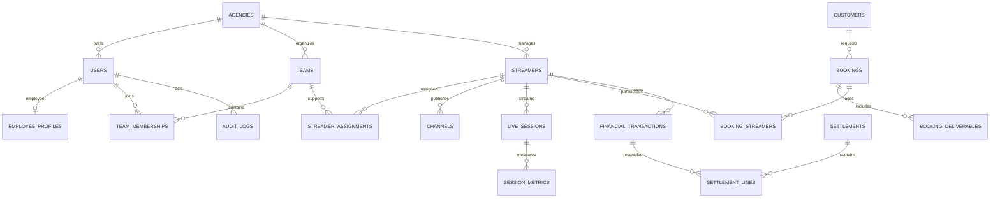

# StreamOps — thiết kế cơ sở dữ liệu

## 1. Nguyên tắc

Thiết kế quan hệ cho PostgreSQL, chuẩn hóa dữ liệu giao dịch; mọi bảng nghiệp vụ thuộc tenant có `agency_id`; PK UUID; thời gian UTC; tiền dùng `numeric(19,4)` và mã tiền tệ; trạng thái lưu bằng mã ổn định. Bảng nghiệp vụ dùng `created_at`, `updated_at`, `created_by`, trạng thái hoạt động khi phù hợp. FK không xóa dây chuyền với dữ liệu tài chính/audit.

Không lưu quyền trong frontend. API lọc tenant/scope. Tên bảng bên dưới là gợi ý số nhiều `snake_case`.

**Ranh giới tin cậy:** public form chỉ ghi application/request; không tạo `users`, `user_roles`, agency hay role. Mọi quan hệ FK cần tenant-consistency; không dùng ID client gửi làm bằng chứng quyền. Cân nhắc PostgreSQL Row-Level Security (RLS) như lớp phòng thủ bổ sung, nhưng không thay thế authorization ở API; nếu bật, phải set/reset tenant context an toàn theo transaction/connection pooling.

## 2. ERD khái niệm

## 3. Danh mục bảng

### Tổ chức và truy cập

| Bảng | Trường chính | Ghi chú |
|---|---|---|
| `agencies` | `id`, `name`, `slug`, `timezone`, `default_currency`, `status` | Tenant; slug unique |
| `users` | `id`, `agency_id`, `email`, `password_hash`/`identity_subject`, `display_name`, `status`, `last_login_at` | Email unique trong agency; tránh lưu password tự xử lý nếu dùng Identity/OIDC |
| `roles` | `id`, `agency_id` nullable, `code`, `name`, `is_system` | Vai trò hệ thống hoặc tùy chỉnh |
| `permissions` | `id`, `code`, `description` | Danh mục quyền như `finance.settlement.approve` |
| `role_permissions` | `role_id`, `permission_id` | PK ghép |
| `user_roles` | `user_id`, `role_id`, `valid_from`, `valid_to` | Lịch sử gán vai trò |
| `teams` | `id`, `agency_id`, `parent_team_id`, `code`, `name`, `lead_user_id`, `status` | Cây đội; code unique theo agency |
| `team_memberships` | `id`, `team_id`, `user_id`, `membership_role`, `valid_from`, `valid_to` | Lưu lịch sử; chỉ một membership chính hiệu lực nếu quy định |
| `employee_profiles` | `id`, `agency_id`, `user_id`, `employee_code`, `job_title`, `manager_user_id`, `hire_date`, `end_date`, `employment_status` | HR profile; trường nhạy cảm nên tách bảng/quyền riêng |
| `employee_private_data` | `employee_id`, `encrypted_identifier`, `salary_band`, `private_notes` | Mã hóa/giới hạn quyền; chỉ thêm khi đồ án cần |
| `hr_workflows` | `id`, `agency_id`, `employee_id`, `type`, `status`, `owner_user_id`, `due_at` | Tuyển dụng/onboarding/offboarding/đánh giá |
| `account_invitations` | `id`, `agency_id`, `email_normalized`, `token_hash`, `proposed_role_id`, `invited_by`, `expires_at`, `accepted_at`, `revoked_at`, `status` | Token hash unique; một lần; không chứa raw token; role là đề xuất và phải được cấp quyền hợp lệ |
| `user_sessions` (nếu tự quản lý session) | `id`, `user_id`, `refresh_token_hash`, `expires_at`, `revoked_at`, `created_at` | Ưu tiên Identity/OIDC; refresh token rotation và thu hồi; không lưu token thô |

### Streamer và vận hành

| Bảng | Trường chính | Ghi chú |
|---|---|---|
| `streamers` | `id`, `agency_id`, `stage_name`, `legal_name`, `status`, `primary_manager_id`, `timezone`, `started_at`, `ended_at` | Hồ sơ; phân quyền legal name riêng nếu cần |
| `streamer_assignments` | `id`, `agency_id`, `streamer_id`, `team_id`, `user_id`, `assignment_role`, `valid_from`, `valid_to` | Manager/đội hỗ trợ, lịch sử hiệu lực |
| `platforms` | `id`, `code`, `name` | YouTube, Twitch, TikTok… |
| `channels` | `id`, `agency_id`, `streamer_id`, `platform_id`, `external_channel_id`, `handle`, `url`, `status` | Unique `(platform_id, external_channel_id)` theo agency |
| `contracts` | `id`, `agency_id`, `streamer_id`, `contract_type`, `status`, `valid_from`, `valid_to`, `document_id` | Metadata hợp đồng; file lưu nơi riêng và kiểm soát quyền |
| `revenue_share_rules` | `id`, `agency_id`, `streamer_id`, `revenue_type`, `streamer_rate`, `agency_rate`, `valid_from`, `valid_to`, `approved_by`, `version` | Tổng tỷ lệ phải theo chính sách; snapshot vào settlement |
| `live_schedules` | `id`, `agency_id`, `streamer_id`, `channel_id`, `campaign_id`, `planned_start_at`, `planned_end_at`, `status`, `created_by` | Check kết thúc > bắt đầu; timezone trình bày riêng |
| `live_sessions` | `id`, `agency_id`, `schedule_id`, `streamer_id`, `channel_id`, `actual_start_at`, `actual_end_at`, `status`, `external_session_id`, `source` | Unique external ID khi có |
| `session_metrics` | `id`, `agency_id`, `live_session_id`, `metric_code`, `value`, `unit`, `captured_at`, `source`, `entered_by`, `import_batch_id` | Một metric có thể nhiều lần capture; version/source rõ |
| `tasks` | `id`, `agency_id`, `team_id`, `owner_user_id`, `streamer_id`, `booking_id`, `title`, `priority`, `status`, `due_at` | Ít nhất một ngữ cảnh; validate ở DB/API |
| `task_assignees` | `task_id`, `user_id`, `assignment_type` | Người phối hợp |

### Thương mại và tài chính

| Bảng | Trường chính | Ghi chú |
|---|---|---|
| `customers` | `id`, `agency_id`, `name`, `type`, `contact_name`, `email`, `status` | Khách hàng/đối tác |
| `opportunities` | `id`, `agency_id`, `customer_id`, `owner_user_id`, `stage`, `expected_value`, `currency`, `expected_close_date` | Pipeline thương mại |
| `bookings` | `id`, `agency_id`, `customer_id`, `opportunity_id`, `owner_user_id`, `title`, `status`, `starts_at`, `ends_at`, `gross_amount`, `currency` | Dùng decimal, không float |
| `booking_streamers` | `booking_id`, `streamer_id`, `fee_amount`, `currency`, `status` | Phân bổ tham gia |
| `booking_deliverables` | `id`, `booking_id`, `description`, `due_at`, `status`, `accepted_by`, `accepted_at`, `evidence_document_id` | Nghiệm thu |
| `financial_transactions` | `id`, `agency_id`, `streamer_id`, `booking_id`, `type`, `category`, `amount`, `currency`, `occurred_at`, `recorded_at`, `status`, `source`, `reference`, `document_id`, `reversal_of_id` | Bản ghi không xóa sau posted; amount có quy ước dấu hoặc type rõ |
| `settlement_periods` | `id`, `agency_id`, `period_start`, `period_end`, `status`, `created_by`, `approved_by`, `locked_at` | Không chồng lấn khi cùng kỳ/phạm vi theo chính sách |
| `settlements` | `id`, `agency_id`, `period_id`, `streamer_id`, `currency`, `gross_revenue`, `deductions`, `streamer_share`, `agency_share`, `rule_snapshot`, `status`, `submitted_at`, `approved_at` | Snapshot JSON chỉ cho tỷ lệ đã áp dụng; số tổng có cột riêng |
| `settlement_lines` | `id`, `settlement_id`, `transaction_id`, `amount`, `line_type` | Unique transaction trong settlement phù hợp chính sách |
| `payouts` | `id`, `agency_id`, `settlement_id`, `amount`, `currency`, `status`, `payment_reference`, `paid_at`, `recorded_by` | Không lưu thông tin ngân hàng đầy đủ nếu không bắt buộc |
| `approval_requests` | `id`, `agency_id`, `entity_type`, `entity_id`, `requested_by`, `reviewed_by`, `decision`, `reason`, `decided_at` | Tạo/duyệt độc lập, chống tự duyệt |

### Hỗ trợ và kiểm toán

| Bảng | Trường chính | Ghi chú |
|---|---|---|
| `campaigns` | `id`, `agency_id`, `name`, `type`, `owner_team_id`, `starts_at`, `ends_at`, `budget`, `currency`, `status` | Có thể nối với lịch/booking |
| `documents` | `id`, `agency_id`, `owner_type`, `owner_id`, `storage_key`, `file_name`, `mime_type`, `size_bytes`, `uploaded_by`, `classification` | File storage ngoài DB; URL ký hạn ngắn |
| `notifications` | `id`, `agency_id`, `user_id`, `type`, `payload`, `read_at`, `created_at` | Payload không chứa bí mật |
| `audit_logs` | `id`, `agency_id`, `actor_user_id`, `action`, `entity_type`, `entity_id`, `occurred_at`, `request_id`, `before_json`, `after_json` | Append-only; loại trường nhạy cảm khỏi snapshot |
| `import_batches` | `id`, `agency_id`, `type`, `file_name`, `status`, `row_count`, `error_count`, `created_by`, `completed_at` | Ghi nguồn dữ liệu nhập |
| `streamer_applications` | `id`, `received_at`, `applicant_name`, `email_normalized`, `platform_links`, `consent_at`, `status`, `assigned_to`, `retention_until`, `converted_streamer_id` | Public intake; không có `user_id`, role hoặc quyền; hạn chế PII và thời gian lưu |
| `partnership_requests` | `id`, `received_at`, `organization_name`, `contact_name`, `email_normalized`, `request_summary`, `consent_at`, `status`, `assigned_to`, `retention_until`, `converted_customer_id` | Public intake CRM; không cấp tài khoản đối tác |
| `public_submission_events` | `id`, `request_type`, `request_id`, `event_type`, `occurred_at`, `actor_user_id`, `metadata` | Audit xử lý form; tránh lưu raw IP lâu dài, chỉ lưu tín hiệu chống lạm dụng theo chính sách |

## 4. Ràng buộc và chỉ mục

- FK mọi thực thể nghiệp vụ về `agencies`; enforce đồng nhất tenant bằng unique composite `(agency_id, id)` và FK composite nơi phù hợp.
- Unique `(agency_id, lower(email))`; `(agency_id, code)` cho team/employee; unique kênh theo platform/external ID.
- Check `planned_end_at > planned_start_at`, `actual_end_at > actual_start_at`, `amount >= 0` nếu dùng type riêng; tỷ lệ trong `[0,1]` hoặc `[0,100]` nhưng chọn một cách thống nhất.
- Index `(agency_id, status)`, lịch theo `(agency_id, planned_start_at)`, assignment `(streamer_id, valid_from, valid_to)`, giao dịch `(agency_id, occurred_at, type)`, settlement `(period_id, status)`, audit `(agency_id, occurred_at)`.
- Tránh unique constraint đơn giản cho lịch không trùng nếu cho phép lịch của streamer trên các kênh khác nhau; cân nhắc PostgreSQL exclusion constraint theo streamer/kênh và khoảng thời gian.
- Pagination cursor/offset có giới hạn; báo cáo lớn truy vấn tổng hợp riêng.
- Invitation: unique token hash, `expires_at > created_at`, trạng thái nhất quán; không chấp nhận nếu email, agency hoặc role proposal không khớp.
- FK composite `(agency_id, role_id)`/`(agency_id, user_id)` ngăn gán role hoặc quan hệ chéo tenant. ID public application chỉ tham chiếu bảng intake, không dùng chung ID user.
- Public applications nên có index `(status, received_at)` và retention index; hạn chế unique email cứng nếu một người có thể gửi lại sau thời gian lưu.
- Dùng `citext` hoặc unique index lower-case cho email; chuẩn hóa trước khi tìm account để chống trùng do chữ hoa/thường.
- Không lưu credential trong `users` tự thiết kế nếu dùng ASP.NET Core Identity; dùng bảng Identity chuẩn và thêm profile liên kết.

## 4.1 Bootstrap và vòng đời quyền

- Bootstrap admin không nên là public API. Dùng command/script triển khai one-shot đọc secret từ secret store/environment; transaction kiểm tra chưa có admin, tạo user/role/assignment đầu tiên, sau đó vô hiệu secret.
- Không seed mật khẩu mặc định; bắt buộc đổi credential/thiết lập MFA nếu khả thi trước khi dùng thực tế.
- Gán/thu hồi role phải ghi `actor`, thời gian, lý do, role cũ/mới; không cho actor tự cấp quyền vượt quyền của mình.
- Nếu cần self-registration nội bộ về sau, chỉ tạo yêu cầu chờ duyệt tách biệt; user pending không có role và không gọi API nghiệp vụ.

## 5. Trạng thái được phép

- Streamer: `lead`, `onboarding`, `active`, `paused`, `ended`.
- Schedule: `draft`, `proposed`, `confirmed`, `live`, `completed`, `cancelled`, `missed`.
- Booking: `lead`, `proposed`, `confirmed`, `in_progress`, `delivered`, `invoiced`, `closed`, `cancelled`.
- Transaction: `draft`, `posted`, `reversed`; không sửa posted, điều chỉnh qua reversal.
- Settlement: `draft`, `submitted`, `approved`, `rejected`, `locked`, `paid`, `cancelled`.
- HR workflow: `draft`, `in_progress`, `awaiting_review`, `completed`, `cancelled`.
- Account: `invited`, `active`, `suspended`, `deactivated`; invitation: `pending`, `accepted`, `expired`, `revoked`.
- Public application/request: `received`, `reviewing`, `shortlisted`, `accepted`, `rejected`, `closed`, `deleted/anonymized`.

Mỗi chuyển trạng thái được triển khai bằng command/domain service có kiểm tra actor, scope, điều kiện và audit.

## 6. Ví dụ truy vấn KPI

KPI dashboard không nên suy ra doanh thu từ số liệu view. Truy vấn tổng hợp phải lọc agency, tiền tệ, khoảng thời gian, trạng thái posted và loại giao dịch. Các metric session có `metric_code`/`unit` nhất quán; định nghĩa trung bình phải ghi rõ là trung bình theo phiên hay theo thời lượng.
