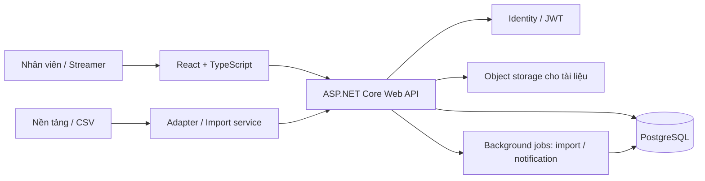

# StreamOps — kiến trúc, API và lộ trình

## 1. Kiến trúc đề xuất

Khởi đầu bằng modular monolith: một API deploy được, chia module theo nghiệp vụ. Tránh microservice cho đồ án vì tăng chi phí đồng bộ giao dịch và triển khai.

### Module backend

`Identity & Access`, `Organization & HR`, `Streamer CRM`, `Live Operations`, `Tasks`, `Booking & Campaigns`, `Finance & Settlement`, `Analytics & Reporting`, `Notifications & Audit`.

Mỗi request cần authentication, xác định agency từ claim, authorization policy, validation, xử lý nghiệp vụ và audit. Trả lỗi theo cấu trúc Problem Details với mã lỗi ổn định.

## 2. API REST gợi ý

Prefix `/api/v1`; mọi danh sách có phân trang, sort/filter allowlist; ngày ISO-8601.

| Nhóm | Endpoint mẫu |
|---|---|
| Tài khoản | `POST /auth/login`, `GET /me`, `POST /users/invitations` |
| Tổ chức/HR | `GET/POST /teams`, `POST /teams/{id}/members`, `GET/POST /employees`, `POST /employees/{id}/workflows` |
| Streamer | `GET/POST /streamers`, `GET/PATCH /streamers/{id}`, `POST /streamers/{id}/assignments` |
| Lịch/phiên | `GET/POST /schedules`, `POST /schedules/{id}/confirm`, `POST /sessions/{id}/complete`, `POST /sessions/{id}/metrics` |
| Booking | `GET/POST /bookings`, `POST /bookings/{id}/deliverables`, `POST /deliverables/{id}/accept` |
| Tài chính | `POST /transactions`, `POST /settlement-periods`, `POST /settlements/{id}/submit`, `POST /settlements/{id}/approve`, `POST /payouts/{id}/mark-paid` |
| Báo cáo | `GET /reports/streamer-performance`, `GET /reports/revenue`, `GET /dashboard/summary` |
| Audit | `GET /audit-logs` (chỉ quyền cho phép) |

Không tạo endpoint `PATCH status` tổng quát cho duyệt/khóa; dùng command endpoint có policy và điều kiện. Các thao tác tạo/import có thể nhận `Idempotency-Key` để tránh ghi trùng khi retry.

## 3. Màn hình React đề xuất

1. Đăng nhập và chọn agency nếu tài khoản được cấp nhiều tenant.
2. Dashboard tùy vai trò.
3. Danh sách streamer, trang chi tiết với tab tổng quan/lịch/booking/tài chính/tài liệu/lịch sử.
4. Lịch live tuần/tháng và bảng phiên.
5. Công việc theo bảng trạng thái và danh sách hạn.
6. CRM booking: khách hàng, pipeline, deliverables.
7. Finance: giao dịch, kỳ đối soát, màn hình preview, duyệt, payout.
8. HR: nhân viên, đội, onboarding/offboarding, đánh giá; trường riêng tư theo quyền.
9. Báo cáo có bộ lọc và mô tả định nghĩa KPI.
10. Cấu hình đội, vai trò, quyền, danh mục nền tảng và audit.

Mỗi trang có loading/empty/error state, phân trang, xác nhận trước thao tác quan trọng, khả năng truy cập bàn phím và thông báo rõ kết quả.

## 4. Quy tắc thiết kế bảo mật

- JWT/OIDC có issuer/audience/expiry; refresh token an toàn nếu dùng; thu hồi khi offboarding.
- Mặc định từ chối; policy server-side, không dựa vào nút ẩn trên React.
- Truy vấn repository bắt buộc `agency_id`; kiểm tra object-level authorization trước thao tác đọc/sửa.
- Không trả trường nhạy cảm nếu DTO không cần; mask log; tài liệu private chỉ tải qua URL ký ngắn hạn.
- Ghi audit cho gán quyền, truy cập HR nhạy cảm, thay đổi hợp đồng/tỷ lệ chia, duyệt và khóa tài chính.
- Import file kiểm tra loại/kích cỡ, chống CSV formula injection khi xuất, báo lỗi theo dòng, có thể chạy preview trước commit.
- CORS allowlist; rate limit login; kiểm tra upload; secrets không commit vào Git.

### Ranh giới tài khoản và public intake

- Public site và app nội bộ là hai mặt giao diện với API/policy riêng. Public endpoints chỉ nhận application/request và nội dung liên hệ; không có endpoint public `register user`, `assign role`, `create agency` hoặc `create admin`.
- Nhân viên được mời bởi admin; streamer chỉ được mời sau khi hồ sơ hợp tác được duyệt. Link mời chứa token ngẫu nhiên tối thiểu 256 bit, DB chỉ lưu hash, hết hạn ngắn, một lần, có thể thu hồi; không đưa token vào log/referrer/analytics.
- Admin bootstrap chạy từ môi trường triển khai, one-shot, không route internet, chỉ khi chưa có admin. Không để mật khẩu mặc định hoặc secret trong source/config được commit.
- Password dùng ASP.NET Core Identity/IdP, rate limiting và lockout có kiểm soát; MFA bắt buộc cho admin/finance nếu hệ thống thực tế. Thông báo đăng nhập/khôi phục không phân biệt email tồn tại.
- Public form cần validation server-side, giới hạn request theo IP/tín hiệu abuse, chống bot, giới hạn dung lượng/loại file, mã hóa truyền tải, chính sách consent/retention, quyền truy cập queue và xóa/ẩn danh. Không lưu thông tin thẻ/ngân hàng hay dữ liệu nhạy cảm không cần thiết.

### Chống rò rỉ chéo dữ liệu

- Authentication riêng authorization; default deny; kiểm tra quyền trên mọi request và object, bao gồm export, file download, search, count và báo cáo.
- Agency lấy từ claim đã kiểm chứng, không từ query/body/header do client tự đặt. Mọi query và command mang tenant scope xuyên suốt service/repository; composite FK/unique ngăn liên kết bản ghi khác tenant.
- Không trả lỗi khác nhau làm lộ sự tồn tại của tài khoản/đối tượng ngoài scope. DTO allowlist, field-level authorization cho HR, hợp đồng, doanh thu và thông tin payout.
- Dùng transaction và concurrency token cho cấp quyền/duyệt tài chính; chống CSRF nếu cookie auth, CORS allowlist, CSP, encode output, parameterized queries và secret management.
- Tài liệu private qua storage private và URL ký thời hạn ngắn; kiểm tra quyền trước khi cấp URL; chặn public bucket.
- Audit append-only cho role/scope changes, xem trường HR nhạy cảm, export/download, settlement, bootstrap và hỗ trợ admin. Log không chứa password, token, PII đầy đủ.
- Backup được mã hóa, quyền truy cập hẹp, có kiểm tra khôi phục; dữ liệu demo dùng thông tin giả.
- RLS PostgreSQL có thể bổ sung phòng thủ; kiểm thử connection pooling/reset tenant context, migration và job nền trước khi dựa vào nó.

## 5. Thứ tự triển khai

### Giai đoạn 0 — Chốt phân tích

Thống nhất use case demo, vai trò, định nghĩa KPI, công thức chia, agency đơn hay multi-tenant, tiền tệ và dữ liệu giả lập. Vẽ context diagram, use-case diagram, ERD chi tiết.

### Giai đoạn 1 — Nền móng

Tạo solution React/API, PostgreSQL migrations, cấu hình môi trường, đăng nhập, agency scope, seed vai trò/đội và audit cơ bản.

### Giai đoạn 2 — Tổ chức và hồ sơ

CRUD đội/nhân viên/streamer, membership/assignment có thời hạn, HR workflow, phân quyền và lọc phạm vi.

### Giai đoạn 3 — Vận hành

Lịch, phiên, metric, task, campaign; kiểm tra xung đột lịch; dashboard vận hành.

### Giai đoạn 4 — Thương mại

Customer, opportunity, booking, deliverables, trạng thái và báo cáo booking.

### Giai đoạn 5 — Tài chính

Transactions, quy tắc chia có hiệu lực, kỳ đối soát, quy trình duyệt độc lập, khóa kỳ, payout và audit.

### Giai đoạn 6 — Hoàn thiện đồ án

CSV import/export, báo cáo, responsive UI, dữ liệu demo, hướng dẫn cài đặt, sơ đồ UML, kịch bản demo và tài liệu giới hạn.

## 6. Tiêu chí nghiệm thu gợi ý

- Người dùng không thể xem dữ liệu agency khác kể cả gọi API trực tiếp.
- HR xem và cập nhật hồ sơ nhân viên theo quyền nhưng không được mở trang/tác vụ tài chính nếu không được cấp.
- Thành viên đội chỉ thao tác dữ liệu theo scope; khi assignment hết hạn quyền tương ứng bị thu hồi.
- Lịch bị cảnh báo/chặn khi xung đột theo chính sách; phiên có thể ghi metric và truy nguyên nguồn.
- Booking không hoàn tất khi deliverable bắt buộc chưa nghiệm thu.
- Người tạo settlement không thể tự duyệt; kỳ khóa không sửa trực tiếp; có đường điều chỉnh.
- Báo cáo có bộ lọc thời gian, scope và đơn vị; số tổng đối chiếu được với giao dịch nguồn.
- Tài khoản bị offboard mất quyền; lịch sử công việc/audit vẫn còn.
- Có hướng dẫn cấu hình, seed, chạy ứng dụng, dữ liệu demo và sơ đồ hệ thống.
- Public form không tạo account/role; không có đường tự đăng ký admin; bootstrap chỉ chạy một lần và không tồn tại route công khai.
- Pending/revoked/expired invitation không thể kích hoạt; token dùng lại hoặc khác email/tenant bị từ chối.
- Kiểm tra truy cập ngang: đổi ID trong URL/body, export, file URL, search và dashboard không thể đọc dữ liệu ngoài agency/team/assignment.
- Tài khoản bị đình chỉ mất quyền truy cập; phiên/refresh token cũ không dùng lại được.
- HR không thể xem trường nhạy cảm ngoài quyền; streamer không đọc ghi chú nội bộ/streamer khác.
- Có kiểm tra giới hạn đăng nhập/form, lỗi validation, upload và audit cho các thao tác nhạy cảm.

Các tiêu chí này là mục tiêu cần kiểm chứng qua review bảo mật và kiểm thử có kiểm soát; tài liệu thiết kế không tự chứng minh hệ thống không có lỗ hổng.

## 7. Tài liệu bàn giao đồ án

- README và hướng dẫn triển khai.
- SRS, quy trình nghiệp vụ, Use Case, ma trận quyền, ERD và data dictionary.
- Sơ đồ kiến trúc, sequence diagram cho onboarding, booking, settlement.
- API specification (OpenAPI/Swagger), migration/seed và từ điển KPI.
- Kịch bản kiểm thử và biên bản kết quả; screenshot giao diện và kịch bản demo.
- Tài khoản demo theo vai trò, dữ liệu giả lập không chứa thông tin cá nhân thật.

## 8. Thuật ngữ

| Thuật ngữ | Ý nghĩa |
|---|---|
| Agency | Công ty/đơn vị quản lý streamer |
| Streamer | Người phát trực tiếp, creator hoặc talent được agency quản lý |
| Booking | Thỏa thuận thương mại/công việc với khách hàng |
| Deliverable | Sản phẩm/quyền lợi phải bàn giao trong booking |
| Settlement | Bảng đối soát khoản thu/khấu trừ và phần chia trong kỳ |
| Payout | Khoản chi trả thực tế đã/đang chuyển cho streamer |
| Scope | Tập đối tượng người dùng được phép thao tác |
| RBAC | Gán quyền thông qua vai trò |
| KPI | Chỉ số hiệu quả có định nghĩa và đơn vị rõ ràng |
